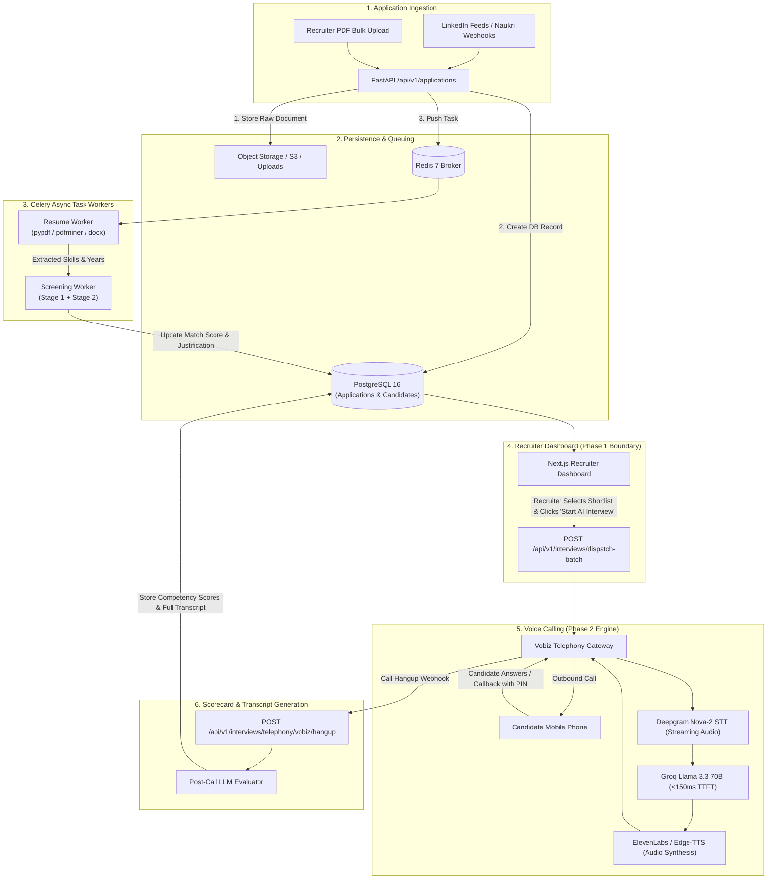
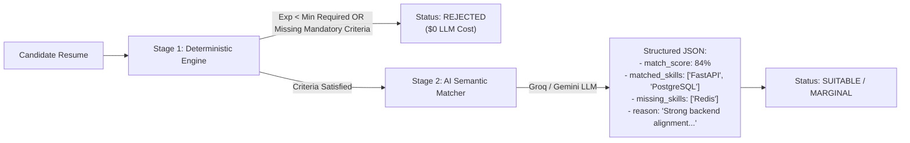
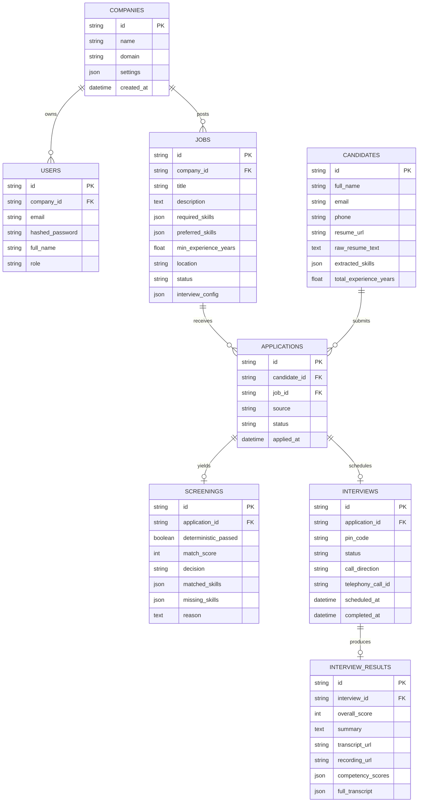
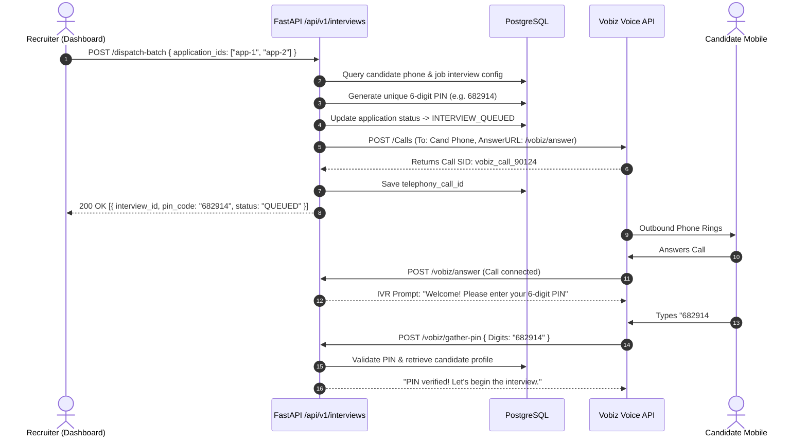
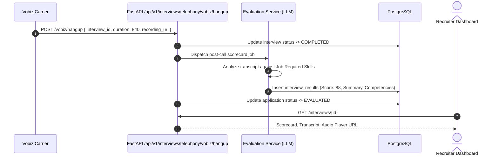

# Backend System Design Document: TalentVoice AI

**Document Version**: 2.0.0  
**Target Audience**: Lead Engineers, DevOps, System Architects  
**Scope**: In-depth architectural blueprint of the FastAPI backend, asynchronous workers, 2-stage screening engine, Vobiz telephony gateway, and audio AI pipelines.

---

## Table of Contents
1. [System Overview & Guiding Principles](#1-system-overview--guiding-principles)
2. [End-to-End Architectural Flow](#2-end-to-end-architectural-flow)
3. [Deep-Dive: Layer-by-Layer Breakdown](#3-deep-dive-layer-by-layer-breakdown)
   - 3.1 Ingestion & Normalization Layer
   - 3.2 Document Extraction Service (`ResumeParserService`)
   - 3.3 Two-Stage Screening Engine (`ScreeningService`)
   - 3.4 Candidate State Machine & Pipeline Lifecycle
   - 3.5 Phase 2 Voice Telephony Gateway (`VobizTelephonyService`)
   - 3.6 Low-Latency Audio AI Pipeline (`VoiceAIService`)
   - 3.7 Asynchronous Task Workers (`Celery` + `Redis`)
4. [Database Architecture & Data Model (PostgreSQL)](#4-database-architecture--data-model-postgresql)
5. [Concurrency, Queuing & Rate Limiting Strategy](#5-concurrency-queuing--rate-limiting-strategy)
6. [Minor to Major Failure Modes & Reflecting Causes](#6-minor-to-major-failure-modes--reflecting-causes)
   - 6.1 Matrix of Failure Modes & Mitigations
   - 6.2 Detailed Architectural Deep-Dive into Edge Cases
7. [API Specification & Sequence Workflows](#7-api-specification--sequence-workflows)

---

## 1. System Overview & Guiding Principles

The TalentVoice backend is an event-driven, asynchronous recruitment orchestrator. It divides the complex recruitment lifecycle into two distinct stages:

```
┌────────────────────────────────────────────────────────┐
│                        PHASE 1                         │
│       Candidate Ingestion & Two-Stage Screening        │
│                                                        │
│  [LinkedIn / Naukri] ──► [Fast Ingestion]              │
│                                 │                      │
│                                 ▼                      │
│                      [Deterministic Rule Filter]       │
│                                 │ (Pass)               │
│                                 ▼                      │
│                         [AI Skill Matcher]             │
│                                 │                      │
│                                 ▼                      │
│                        [Shortlisted by HR]             │
└───────────────────────────────┬────────────────────────┘
                                │
                  Recruiter Clicks "Start Call"
                                │
┌───────────────────────────────▼────────────────────────┐
│                        PHASE 2                         │
│       AI Telephony Interview & Evaluation Engine       │
│                                                        │
│  [Vobiz Outbound Call] ◄──► [Candidate Keypad / Voice] │
│                                 │                      │
│          Inbound PIN Callback ◄─┴─► [Deepgram STT]     │
│                                           │            │
│  [Scorecard + Transcript] ◄── [Groq Conversational LLM]│
└────────────────────────────────────────────────────────┘
```

### Core Design Principles
1. **Decoupled Processing via Queues**: The HTTP API never parses heavy PDF resumes or runs multi-second LLM inferences synchronously. Everything heavy is pushed to Redis queues.
2. **Deterministic Fast-Fails**: 30% to 50% of incoming applications are disqualified by Stage 1 deterministic code rules (experience, keywords, location) for **$0 LLM cost**.
3. **Graceful Degradation**: If an AI voice service (like ElevenLabs) exceeds its free credit quota, the engine falls back to free neural synthesis or carrier IVR without dropping calls.
4. **Idempotent State Progression**: Applications move through a formal state machine (`APPLIED` $\to$ `SUITABLE` $\to$ `SHORTLISTED` $\to$ `INTERVIEW_QUEUED` $\to$ `COMPLETED` $\to$ `EVALUATED`).

---

## 2. End-to-End Architectural Flow



---

## 3. Deep-Dive: Layer-by-Layer Breakdown

### 3.1 Ingestion & Normalization Layer
- **Endpoint**: `POST /api/v1/applications/jobs/{job_id}`
- **Responsibility**: Ingests applicants from disparate sources (LinkedIn, Naukri, Direct Form, Referral) into a normalized `Candidate` and `Application` schema.
- **Deduplication**: Candidates are indexed by `email` and `phone`. If a candidate applies to multiple roles in the same company, a single `Candidate` record is preserved while creating distinct `Application` instances linked to different jobs.

### 3.2 Document Extraction Service (`ResumeParserService`)
- **File**: `app/services/resume_service.py`
- **Supported Formats**: PDF, DOCX, TXT.
- **Extraction Mechanism**:
  1. Plain-text extraction using `pypdf` with fault-tolerant page iteration.
  2. Regex pattern normalization for phone numbers (E.164 and local Indian 10-digit formats).
  3. Skill taxonomy scanning: Matches candidate text against a curated multi-tier technical vocabulary (`FastAPI`, `PostgreSQL`, `Celery`, `Node.js`, `Redis`, `Docker`, `Kubernetes`).
  4. Experience extraction: Extracts explicit year statements (e.g. `"3.5 years of experience"`, `"4+ yrs"`).

### 3.3 Two-Stage Screening Engine (`ScreeningService`)
- **File**: `app/services/screening_service.py`



#### Why Two Stages?
Running LLMs on 10,000 raw resumes wastes API limits and costs unnecessary money. 
- **Stage 1 (Pure Python code, 0ms latency, $0 cost)**: Checks whether the candidate satisfies the job's minimum experience floor.
- **Stage 2 (LLM Semantic Reasoning)**: Analyzes the candidate's actual projects, matched skills, and produces human-readable **evidence** for the recruiter.

---

### 3.4 Candidate State Machine & Pipeline Lifecycle

The `applications` table follows a strict finite state machine:

```
[APPLIED] ──► [PROCESSING] ──► [SUITABLE] ──► [SHORTLISTED] ──► [INTERVIEW_QUEUED]
                  │                  │                               │
                  ▼                  ▼                               ▼
              [REJECTED]         [REJECTED]                   [IN_PROGRESS]
                                                                     │
                                                                     ▼
                                                                [COMPLETED]
                                                                     │
                                                                     ▼
                                                                [EVALUATED]
```

| State | Trigger | Meaning |
| :--- | :--- | :--- |
| `APPLIED` | Candidate submits resume | Initial record created in PostgreSQL. |
| `PROCESSING` | Celery picks up task | Resume text extraction and Stage 1 screening active. |
| `SUITABLE` | Stage 2 AI score $\ge$ 65% | Qualified candidate waiting for recruiter review. |
| `SHORTLISTED` | Recruiter clicks "Shortlist" | Approved by HR for Phase 2 AI interview. |
| `INTERVIEW_QUEUED` | Recruiter clicks "Start AI Interview" | 6-digit PIN created; Vobiz outbound call scheduled. |
| `IN_PROGRESS` | Candidate answers call & enters PIN | Live voice technical interview currently active. |
| `COMPLETED` | Call ends / hangs up | Audio recording saved to S3; transcript ready. |
| `EVALUATED` | Scoring task finishes | Competencies scored (0-100), scorecard attached. |
| `REJECTED` | Stage 1 fail OR HR reject | Candidate disqualified with recorded justification. |

---

### 3.5 Phase 2 Voice Telephony Gateway (`VobizTelephonyService`)
- **File**: `app/services/telephony_service.py`
- Handles communication with Vobiz carrier infrastructure:
  1. **Outbound Dispatch**: Sends REST request to Vobiz `POST /v1/Calls` with candidate phone, company caller ID, and webhook URLs.
  2. **Inbound Callback IVR (`/vobiz/answer`)**: Greets candidate and requests PIN entry:
     ```json
     {
       "action": "gather",
       "num_digits": 6,
       "finish_on_key": "#",
       "say": "Welcome to your AI technical interview. Please enter your 6-digit PIN followed by pound."
     }
     ```
  3. **Keypad PIN Match (`/vobiz/gather-pin`)**: Verifies keypad input against the database. If correct, starts the AI interview session.
  4. **Hangup Webhook (`/vobiz/hangup`)**: Captures call duration, recording URL, and triggers evaluation.

---

### 3.6 Low-Latency Audio AI Pipeline (`VoiceAIService`)
- **File**: `app/services/voice_ai_service.py`
- Designed specifically for **zero-cost operation** and **sub-450ms phone latency**:

```
Candidate Audio (8kHz/16kHz Phone Stream)
                 │
                 ▼
      [Deepgram Nova-2 STT]        ◄── Uses $200 Free Sign-up Credit (~46,500 mins)
                 │ (Live Transcript)
                 ▼
      [Groq Llama 3.3 70B]         ◄── 100% Free Tier (800+ tok/s, <150ms TTFT)
                 │ (Token Stream)
                 ▼
      [ElevenLabs / Edge-TTS]      ◄── 10,000 Free Chars/mo + Free Neural Fallback
                 │ (Audio Chunks)
                 ▼
      Vobiz Telephony Audio Out
```

---

## 4. Database Architecture & Data Model (PostgreSQL)



### Critical Performance Indexes
- `idx_app_job_status` on `applications(job_id, status)`: Powers the instant recruiter dashboard pipeline counts in sub-5ms.
- `idx_candidate_email` on `candidates(email)`: Ensures candidate deduplication during high-volume ingestion.
- `idx_interview_pin` on `interviews(pin_code)`: Instant O(1) lookup when a candidate calls back and inputs digits on the phone keypad.

---

## 5. Concurrency, Queuing & Rate Limiting Strategy

1. **Celery Multi-Worker Queue Partitioning**:
   - `queue:resume-parsing` (CPU-bound worker pool, concurrency 4).
   - `queue:screening` (IO/Network-bound worker pool, concurrency 16).
   - `queue:telephony` (Priority queue, concurrency 32).
2. **Telephony Concurrency Throttling (Redis Leaky Bucket)**:
   - If a company clicks "Start AI Interviews" for 500 candidates simultaneously, the backend **does not** dial 500 numbers at once (which would trigger telecom spam flags).
   - Redis controls concurrency: **Max 20 concurrent outbound calls per company**. As one call finishes, the next is dispatched immediately.

---

## 6. Minor to Major Failure Modes & Reflecting Causes

Any distributed system handling external telecommunications, document uploads, and AI APIs will face edge cases. The following matrix details how the system detects and recovers from each failure mode:

### 6.1 Matrix of Failure Modes & Mitigations

| Failure Severity | Event / Root Cause | Immediate System Impact | Root Reflecting Cause & Automated Recovery Mechanism |
| :--- | :--- | :--- | :--- |
| **MAJOR** | **Telephony Call Drop / Mid-Interview Disconnect** | Audio cuts out at minute 6 of a 15-minute call. | **Reflecting Cause**: Carrier packet loss, candidate entering an elevator or tunnel.<br/>**Recovery**: Vobiz sends `hangup` event with `duration < min_threshold`. The system marks interview as `CALL_INTERRUPTED`, saves existing transcript turns, and triggers an SMS: *"Your interview was disconnected. Dial +91-XXXXX and enter PIN 682914 to resume from where you left off."* |
| **MAJOR** | **LLM API Rate-Limit (HTTP 429)** | Groq or Gemini returns 429 during active screening. | **Reflecting Cause**: Burst of 500 applicants parsed within 60 seconds.<br/>**Recovery**: Celery automatic exponential backoff retry (`max_retries=3`, countdown=10s, 30s, 60s). Fallback chain automatically switches from Groq $\to$ Gemini $\to$ Heuristic rule matcher. |
| **MAJOR** | **TTS Free Quota Depleted** | ElevenLabs 10k character free limit exhausted. | **Reflecting Cause**: High interview volume on free tier.<br/>**Recovery**: `VoiceAIService` catches ElevenLabs 401/429 error and smoothly falls back to free Edge-TTS / Vobiz default carrier speech. The call continues with 0 interruption. |
| **MODERATE** | **Scanned Image Resume (Non-Selectable PDF)** | `pypdf` extracts 0 characters from PDF. | **Reflecting Cause**: Candidate uploaded a scanned screenshot/image PDF.<br/>**Recovery**: If extracted text length $< 50$ characters, `ResumeParserService` flags document as `SCANNED_DOCUMENT_REQUIRES_OCR`, moves application to `MANUAL_REVIEW`, and notifies recruiter rather than crashing the worker. |
| **MODERATE** | **Candidate Inputs Wrong PIN on Phone Keypad** | Keypad digits do not match database. | **Reflecting Cause**: Typo or candidate calling from a different family member's phone.<br/>**Recovery**: Vobiz IVR plays: *"That PIN is invalid. You have 2 attempts remaining."* After 3 failed attempts, IVR politely disconnects and sends an SMS with the correct PIN. |
| **MODERATE** | **Duplicate Application Submission** | Same candidate applies from both LinkedIn and Naukri. | **Reflecting Cause**: Multi-channel applicant hunting.<br/>**Recovery**: Email/phone deduplication detects existing candidate ID. Associates second submission as an alias without running duplicate screening tasks or creating duplicate calling jobs. |
| **MINOR** | **Unconventional Experience Format in Resume** | Resume states `"Worked from 2021 to 2024"` instead of `"3 years"`. | **Reflecting Cause**: Variations in candidate formatting.<br/>**Recovery**: Date-range regex calculates `2024 - 2021 = 3.0 years`. If no date or explicit number is found, defaults experience to `0.0` and lets Stage 2 LLM infer total seniority from job titles. |
| **MINOR** | **Candidate Background Noise During Voice Call** | Barking dog or street traffic heard over phone. | **Reflecting Cause**: Ambient acoustic noise on mobile carrier.<br/>**Recovery**: Deepgram Nova-2 background acoustic noise filter (`smart_format=true`, `endpointing=400ms`) prevents false-trigger speech detection. |

---

## 7. API Specification & Sequence Workflows

### 7.1 Dispatching Phase 2 AI Interviews



### 7.2 Post-Call Evaluation Workflow



---

## 8. Summary of Directory Structure

```
backend/
├── app/
│   ├── main.py                     # App entry point, CORS, lifespan database init
│   ├── core/
│   │   ├── config.py               # Pydantic Settings & environment variables
│   │   ├── database.py             # Async SQLAlchemy engine & session factory
│   │   └── security.py             # JWT token utilities & password hashing
│   ├── models/                     # Relational SQLAlchemy models
│   │   ├── company.py, user.py, job.py, candidate.py,
│   │   ├── application.py, screening.py, interview.py
│   ├── schemas/                    # Pydantic v2 validation contracts
│   ├── services/                   # Business logic layer
│   │   ├── resume_service.py       # PDF/DOCX text & skill extraction
│   │   ├── screening_service.py    # Stage 1 deterministic + Stage 2 AI reasoning
│   │   ├── telephony_service.py    # Vobiz outbound, IVR gather & hangup handlers
│   │   ├── voice_ai_service.py     # Deepgram, ElevenLabs, Groq & Gemini integration
│   │   └── interview_service.py    # 6-digit PIN generation & session orchestration
│   ├── workers/                    # Distributed Celery tasks
│   │   ├── celery_app.py           # Celery broker configuration
│   │   ├── resume_tasks.py         # Async resume parsing worker
│   │   └── screening_tasks.py      # Async 2-stage screening worker
│   └── api/v1/                     # REST API routers
│       ├── auth.py, jobs.py, candidates.py,
│       ├── applications.py, interviews.py, router.py
├── docs/
│   └── BACKEND_SYSTEM_DESIGN.md    # This exhaustive architecture specification
├── Dockerfile                      # Production container image
├── docker-compose.yml              # API, Worker, PostgreSQL & Redis services
└── requirements.txt                # Python dependencies
```
